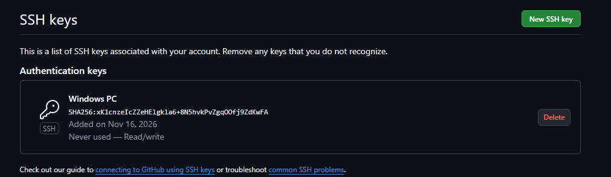

# Настройка SSH-доступа к GitHub

## Среда выполнения
Задание выполнено на ОС Windows (командная строка CMD).

## 1. Проверка SSH-клиента и генерация ключей
- Проверен SSH-клиент командой `ssh -V`.
- Сгенерирована пара ключей ed25519 командой:
  `ssh-keygen -t ed25519 -C "jopaoslyonka@gmail.com"`
- Приватный ключ сохранен в `C:\Users\slava\.ssh\id_ed25519` и защищен passphrase (парольной фразой).
- Публичный ключ сохранен в `C:\Users\slava\.ssh\id_ed25519.pub`.

*Подтверждение защиты ключа паролем (запрос passphrase):*

## 2. Добавление ключа в GitHub
Публичный ключ скопирован и добавлен в аккаунт GitHub (Settings -> SSH and GPG keys).
*Скриншот добавления ключа:*

## 3. Проверка подключения
Выполнена команда:
`ssh -T git@github.com`
Успешный ответ GitHub: `Hi ushaa000! You've successfully authenticated...`

*Успешный ответ GitHub:*

## 4. Работа с репозиторием по SSH
- Репозиторий клонирован по SSH-URL: `git clone git@github.com:ushaa000/ssh-github-setup.git`
- Внесены изменения (создан этот README).
- Выполнен `git commit` и `git push` без запроса пароля от GitHub (использован SSH-ключ).

## Ссылка на репозиторий
https://github.com/ushaa000/ssh-github-setup